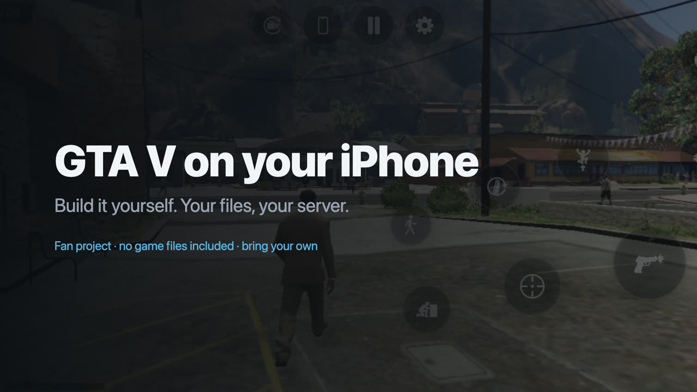

# GTA V on iPhone (build-it-yourself port)

[](https://github.com/kevinerikjs/gta5-ios-port/releases/download/v1.0/gta5-ios-port-tutorial.mp4)

*Click the image for the 70-second setup video.*

A fan project that runs the WebAssembly build of GTA V natively on iPhone: engine compiled to ARM64, a native Metal renderer with every shader precompiled, Story mode or free-roam Sandbox, touch controls that act as a real controller (with the game's own aim assist), gyro aiming, tilt steering, graphics presets and an option to download the whole game to the phone.

**This repository contains no game files and no game code.** You need your own copy of the game files; the build turns them into an app on your own build machine, and your phone streams the rest from your own computer. Nothing here downloads game content from anywhere else.

> Not affiliated with or endorsed by Rockstar Games or Take-Two Interactive. Rights holders: contact kevin@aether.ee and the repository will be taken down promptly.

## What you need

- **Your own game files** for web build `8b0b5899ed`: the folder that contains `data/` and `b/8b0b5899ed/` (about 20 GB). The build checks `game.wasm` and stops if it is a different build.
- **A computer that stays on while you play** (Windows, macOS or Linux) to hold those files.
- **[Tailscale](https://tailscale.com)** (free) on that computer and on your iPhone.
- **A free GitHub account** (GitHub builds the app for you, no Mac needed) **or an Apple Silicon Mac** with Xcode (free).
- **A free Apple ID** and **[SideStore](https://sidestore.io) or [AltStore](https://altstore.io)** (or Xcode on a Mac) to install it. No paid Apple subscription is required.
- **An iPhone with 6 GB of RAM or more** (iPhone 13 Pro or newer). It runs well with a free Apple ID; a paid developer account adds memory headroom and a 1-year signature (see *Free vs paid*).

## 1. Serve your game files over Tailscale

1. Install Tailscale on your computer and phone and sign in to the same account on both.
2. In the Tailscale admin console, under **DNS**, turn on **MagicDNS** and **HTTPS Certificates**.
3. On the computer, share the game folder (the one containing `data/` and `b/`):
   ```sh
   tailscale serve --bg "/path/to/your/game-files"
   ```
4. Run `tailscale serve status`. It shows your server address, like `https://my-pc.tailnet-name.ts.net`. Open `https://my-pc.tailnet-name.ts.net/data/manifest.json` in Safari on your phone; if you see text, the server works.

Only devices on your own tailnet can reach it. To stop sharing: `tailscale serve --https=443 off`.

## 2. Build your app on GitHub

1. On this repository's page, press **Use this template** and **Create a new repository**, and choose **Private**. The build refuses to run in a public copy, because the finished app contains the game engine from your files.
2. In the Tailscale admin console, open **Settings, Keys, Generate auth key**: turn on **Reusable** (so a re-run works) and **Ephemeral** (the build machine leaves your tailnet when it is done), pick a short expiry such as 7 days, then copy the key.
3. In your new repository: **Settings, Secrets and variables, Actions, New repository secret**. Add two secrets:
   - `TS_AUTHKEY`: the key from step 2.
   - `GAME_SERVER_URL`: your server address from part 1, e.g. `https://my-pc.tailnet-name.ts.net`.
4. Open the **Actions** tab, choose **Build my IPA**, press **Run workflow**. Tick *paid account* only if you have a paid Apple developer account.
5. Wait about 25 minutes. When it is done, open the run and download **GTA5Port-ipa** (a zip with `GTA5Port.ipa` inside).

Cost: private repositories get free GitHub Actions minutes every month (2,000 on the free plan). macOS minutes count ten times, so one 25-minute build uses about 250 of them: roughly eight builds a month for free. GitHub only charges if you raise your spending limit above zero. If your account has an old billing problem, every run fails instantly with *startup_failure*; fix the payment method in GitHub's billing settings.

## 3. Install and play

1. Install SideStore (or AltStore) on your iPhone using its own guide.
2. Unzip the download and open `GTA5Port.ipa` with SideStore/AltStore. Free Apple IDs need the app refreshed every 7 days; SideStore can do that on the phone.
3. Keep Tailscale connected, open the app, choose **Story mode** (the campaign, with saves) or **Sandbox** (free roam), and press **Play**. Your server is already filled in (tap it to change it). The first launch downloads about 4 GB into the app; later launches start much faster.
4. Optional: **Settings, Game files, Download all game files** copies the whole game (about 21 GB) onto the phone, so it no longer streams from your computer while you play. It checks free space first, shows progress and continues after the app is closed and reopened.

## Two ways to build (both work with a free Apple ID)

| | GitHub Actions (above) | Your own Mac |
|---|---|---|
| Needs | a free GitHub account | an Apple Silicon Mac with Xcode (free) |
| Apple account | free Apple ID | free Apple ID |
| Install with | SideStore / AltStore | Xcode directly, or SideStore / AltStore |
| Time | about 25 minutes | about 30 to 60 minutes |

A free Apple ID works well: the app is re-signed every 7 days and gets a smaller memory budget. A paid Apple developer account (99 USD/year) gives a 1-year signature and the full memory budget; see *Free vs paid* below.

### Building on your Mac

Install Xcode from the App Store, then `brew install xcodegen`. In this folder:
```sh
./build_ipa.sh https://my-pc.tailnet-name.ts.net          # free Apple ID
./build_ipa.sh https://my-pc.tailnet-name.ts.net --paid   # paid developer account
```
This makes `GTA5Port.ipa` next to the script; install it with SideStore/AltStore. To install straight from Xcode instead, open `app/PlayGTA5Native.xcodeproj` (created by the script), choose your iPhone as the destination, pick your Apple ID under **Signing & Capabilities** (free accounts appear as *Personal Team*; change the bundle identifier to something unique if Xcode asks), and press **Run**. The server can also be any HTTP(S) server that supports range requests.

## Free vs paid Apple account

| | Free Apple ID | Paid Apple Developer account (99 USD/year) |
|---|---|---|
| Works | yes | yes |
| Memory iOS allows the app | normal limit | *Increased Memory Limit* + *Extended Virtual Addressing* |
| Experience | **smooth on the lighter presets**: about 25 to 31 FPS at the 30 FPS cap on an iPhone 13 Pro Max | the same, plus room for higher presets on phones with more RAM |
| Re-sign | every 7 days | once a year |

The game needs a lot of memory. Without the two memory entitlements (only paid accounts can grant them) iOS keeps the app on a smaller budget, so it uses the lighter presets. Since version 1.1 (native Metal renderer) the app needs about 700 MB less memory, and a free Apple ID plays smoothly: tested on an iPhone 13 Pro Max (6 GB), about 25 to 31 FPS while driving around the map, with memory to spare. A paid account mainly adds headroom for higher presets and the longer signature.

### Using a paid account for the full-memory version

1. Join the [Apple Developer Program](https://developer.apple.com/programs/) and note your **Team ID** (developer.apple.com, Membership).
2. Register your iPhone: connect it to a Mac running Xcode once, or add its UDID under Certificates, Identifiers & Profiles, Devices.
3. Build with the memory entitlements:
   - **On a Mac (most reliable):**
     ```sh
     ./build_ipa.sh https://my-pc.tailnet-name.ts.net --paid
     ```
     Then open `app/PlayGTA5Native.xcodeproj`. Under **Signing & Capabilities**, pick your paid team, change the bundle identifier to something unique (e.g. `com.yourname.gta5port`), and check that **Increased Memory Limit** and **Extended Virtual Addressing** are listed (add them with **+ Capability** if not). Choose your iPhone and press **Run**.
   - **With GitHub Actions:** run the workflow with **paid account** ticked; the IPA then asks for both entitlements. Install it with a signing tool that uses your paid account (AltStore/SideStore signed in with the paid Apple ID). If the app still feels as laggy as the free build, the tool dropped the entitlements; use the Mac route above.
4. In the app, open **Settings**: the bottom line shows the memory limit iOS granted. With the entitlements it should be well above the free-account value (on a 6 GB phone, about 4,000 MB instead of about 3,000 MB), and higher graphics presets unlock.

## Controls and settings

Settings (gear icon, top centre) has the game mode (Story or Sandbox, applied at the next launch), graphics presets and resolution, touch control size/opacity and stick speeds, targeting mode (assisted aim by default), gyro aiming and tilt steering. Bluetooth controllers work too.

## How it works

- The engine (`game.wasm` from your files) is translated to C with [wasm2c](https://github.com/WebAssembly/wabt) and compiled to ARM64 at build time; iOS does not allow compiling code on the phone.
- Graphics use this project's own Metal renderer (`app/Source/MetalRenderer`). It executes the game's Direct3D 11-style command stream directly on Metal. At build time, the game's shaders from your files are translated to Metal with `app/ShaderTool` (built on Google's [Tint](https://dawn.googlesource.com/dawn), BSD-3-Clause/Apache-2.0, prebuilt in this project's releases) and precompiled into the app, so nothing is compiled on the phone while you play.
- Touch input feeds the engine's own controller code, so GTA's controller features (assisted aim, analog driving) work.
- Game files stream from your server into a block cache in the app.

## Community

This project is published as is and is **not actively maintained**, so it will most likely not get updates or support. The Telegram community [t.me/reGRANDTA](https://t.me/reGRANDTA) may be able to help with setup questions and anything else; it is not run by this project's author.

## License

The code written for this project is MIT licensed (see `LICENSE`). It does not cover the game, its data, or the third-party files fetched at build time.
